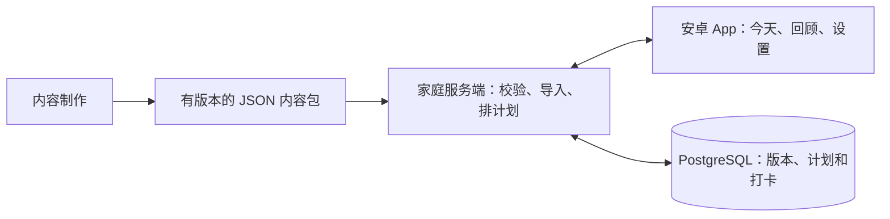

> 2026-11-13版本说明：本轮新设计与实施依据为项目根目录 `docs/v2/`、`contracts/v2/` 和 `prototype/v2/`。下文保留旧阶段记录；单设备、一日一卡及旧待决策不再用于新版实现。通用工作约定继续适用。

# 家庭早教跟踪：首版框架定稿

首版用于一个家庭、一台安卓手机。App 给家长看今天怎么陪宝宝玩，提醒补记，并在周末用记录给出一条下周建议。框架覆盖 0～35 月龄；第一套正式内容做 18～23 月，下一套优先做 24～35 月。

## 两条线，一份交接合同

| 部分 | 负责什么 | 交付什么 |
| --- | --- | --- |
| 内容 | 定分龄、主题、活动步骤、儿歌提示、数量玩法、中英文台词、安全说明和七天编排。 | 一份可校验的内容包。每次发新版，只更新包的内容版本。 |
| 开发 | 把内容包导入服务端，给家庭生成每日任务；实现安卓显示、提醒、打卡、同步、周报和 AI 建议。 | Flutter 安卓 App、Fastify + TypeScript 服务端、PostgreSQL。开发先用演示包联调。 |
| 交接 | 内容和开发共用 `schemaVersion: 1`。卡片怎么写由内容侧定，数据怎么读由合同定。 | [内容包格式](../../contracts/content-package.schema.json)、[演示内容包](../../content/demo/demo-content-package.json)和[校验脚本](../../tools/validate_content.py)。格式采用 [JSON Schema 2020-12](https://json-schema.org/draft/2020-12)。 |

只要格式不变，换一首歌、改英文台词、加活动、补新的月龄包，都可以通过导入新版内容完成，无需重新安装 APK。若要增加音频播放器等需要新界面的能力，再一起升级内容格式和 App。

## 家长端固定流程

1. **开始。** 填当前月龄，选提醒时间（默认建议 19:30，可改或关闭），开始七天计划。只有内容包已提供该月龄的计划时，才创建对应的周计划；尚未收录时清楚提示。月龄保存在手机上，按录入后过去的整月估算，可手动修正。
2. **今天。** 每天一张卡。先看「准备什么、怎么做、家长怎么说」，再按需要看儿歌、数感和英文。玩完点「一起玩了」或「今天跳过」，可选一个反馈标签；没点的日期显示「未记录」。支持补记和改记。
3. **提醒与同步。** 安卓安排本地提醒；有任务还没记时最多提醒一次，点通知进对应的卡片。断网可以用已下载的卡片和保存打卡，恢复网络并打开 App 后补传。
4. **本周回顾。** 服务端计算次数，AI 根据已经同步的记录提一条建议。首版只支持一种计划调整：从已收录、适合目标月龄的卡中选一个，替换下周一天的活动。家长确认后才应用。升月龄档也只影响下一周，可先试一张新玩法。

## 内容和历史怎样分开

- **内容版本可更新。** 内容包有独立的 `contentVersion`，导入校验通过后才切到新版本。导入失败继续用上一个版本。
- **已排的任务有自己的内容。** 生成七天计划时，服务端保存每张卡当时的内容和来源版本。新包用于新计划；当周的卡片、过去的打卡和旧回顾仍对应原来的活动。回滚内容包也只影响之后生成的计划。
- **记录归家庭。** 服务端保存周计划、打卡、统计和回顾。宝宝姓名、生日、照片、音视频都不是首版所需数据。模型只接收复盘需要的活动、次数、相对天数和反馈标签。

## 两边可以独立开工

内容侧按[内容实施规范](01-内容实施.md)，将已确定的六个主题写成 18～23 月的正式卡和一套七天计划；开发侧按[开发实施说明](02-开发实施.md)，拿演示包先做「导入 → 安卓真机看卡 → 本地提醒 → 打卡 → 服务端读回」。内容完成后，只替换服务端的包，不返工 App 页面。

首次合并验收：**同一个 APK** 用演示包跑通一周；再导入改过一句台词的新包，生成新一周时能看到新台词，旧周仍显示原句。然后用正式内容替换演示包进入家庭试用。第一版只做这一条使用路径，不需要内容管理后台、公开注册或课程商城。

本文件是首版总体约定。[18 月龄内容清单](../content/18月龄内容清单.md)继续作为内容原稿；之前的七天模板是活动示例，本目录的 `schemaVersion: 1` 是正式导入格式。
