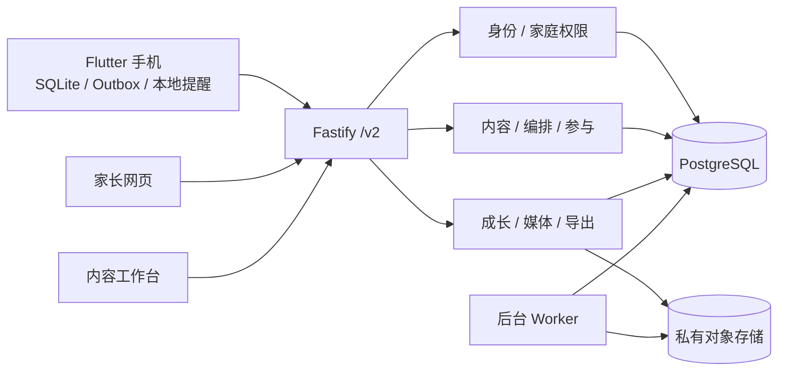
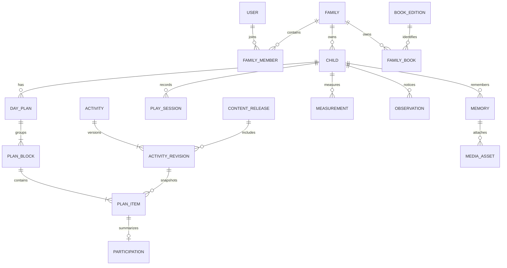
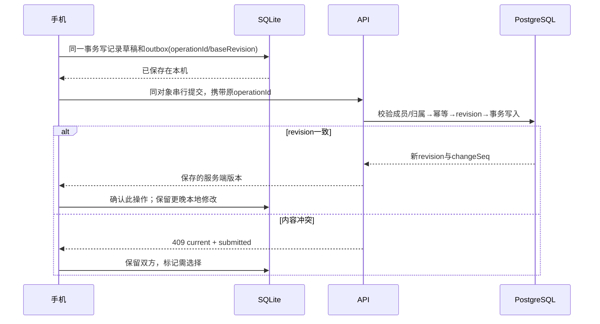

# 技术架构与数据设计

设计状态：可用于实现拆解，未部署服务；API细节见 `contracts/v2/`。不新增微服务或实时大模型依赖。

## 1. 技术选择

| 层 | 采用方案 | 理由 |
| --- | --- | --- |
| Android | Flutter；按功能组织；Repository＋本地SQLite（Drift候选）＋可观察状态 | 与原项目候选一致，缓存和离线写入显式管理；插件版本在开工时锁定 |
| 家长网页/工作台 | React＋TypeScript，两个独立路由入口，共用设计变量与API类型 | 一套家庭事实，两种任务；不把管理员控件混到陪伴页 |
| 服务 | Fastify＋TypeScript模块化单体，REST /v2 | 初期小家庭使用易部署；模块边界比服务拆分更重要 |
| 数据 | PostgreSQL；私有S3兼容对象存储；本机开发可用私有存储适配器 | 事务保证计划和记录一致性，媒体不塞数据库 |
| 异步工作 | PostgreSQL jobs/outbox＋一个worker进程 | 生成安排、缩略图、导出、删除与备份；首版不引入Redis或消息集群 |
| 推送更新 | App前台增量同步，网页事件通知只提示刷新 | 事件不是事实源，漏消息后仍能拉齐；断线不承诺实时可见 |

离线Repository统一提供本地与远端数据，参考[Flutter官方模式](https://docs.flutter.dev/app-architecture/design-patterns/offline-first)。Web首版在线写入，不冒充完整离线客户端。

建议目录：`apps/mobile`、`apps/web`、`services/api`、`services/worker`、`packages/contracts`、`packages/ui-tokens`、`content/candidate`、`content/release`、`infra`。本轮只创建设计产物，避免空工程让人误认App已可运行。

## 2. 模块与核心数据

| 实体 | 关键字段和约束 |
| --- | --- |
| users / sessions | id、email、passwordHash；刷新令牌摘要、deviceId、expiresAt、revokedAt；密码散列采用Argon2id，参数在实现时根据硬件测定；会话可逐设备撤销 |
| families / family_members | timezone、ownerUserId；unique(familyId,userId)，角色owner/caregiver，active状态；最后一位owner不能退出 |
| children | familyId、displayName可空、ageMode=months/birthDate、ageMonths、ageAsOf、birthDate可空；估算年龄与精确年龄不混用 |
| invitations | familyId、tokenHash、expiresAt、acceptedBy；单次使用，事务锁定接受动作；令牌不写日志/分析 |
| activities / revisions | stable activityId、revision、不可变正文、sourceIds、reviewState、withdrawnAt；内容hash；编辑生成新revision |
| books / editions / family_books | 作品与版本分开；familyBook允许editionId空；verified字段必须有来源；家中备注不覆盖公共书目 |
| day_plans | familyId、childId、localDate、timezoneSnapshot、generationVersion、mode、revision；unique(childId,localDate) |
| plan_blocks / items | blockKind、relativeWindow；itemId、slot、position、budgetMinutes、activityRevisionId、完整snapshot、lockedByParent、startedAt、revision |
| participations | unique(planItemId)、status=played/skipped、participantIds、notes按作者分条、actualMinutes可空、revision；未记录为无行 |
| play_sessions | id由客户端生成、childId、activitySnapshot、planItemId可空、localDate、participants、addedBy；同计划再次开展必须显式创建另一session |
| memories | childId、localDate、type=quote/story/first、text、firstConfirmed、addedBy、revision、deletedAt；first必须明确确认 |
| observations | childId、guideId、value=noticed/not_yet_observed/discuss、note、localDate；不保存分数 |
| measurements | childId、localDate、kind、value、unit、method、source、revision；cm/kg；禁止静默把卧位身长改成站立身高 |
| media_assets | familyId、ownerRecordId、objectKey、mime、byteSize、sha256、state=pending/processing/ready/failed/deleted；服务端确认后才能ready |
| operations / changes | actor/device/operationId、requestHash、result；unique(actorUserId,operationId)；单调递增changeSeq，带删除墓碑 |
| content_releases / audits | 版本、revision列表、核验清单、reviewer/publisher、自审标记、状态；发布不可变，撤回另加事件 |
| exports / jobs | familyId、创建者、筛选范围、状态、expiresAt、遗漏清单；jobs用dedupeKey防重复 |

每个家庭对象均有familyId，查询必须同时限定当前活跃成员与对象归属，绝不只按UUID查询。数据库以复合外键 `(childId,familyId)` 等防跨家庭引用。读不到与无权限统一404；管理角色不能借内容ID读取家庭记录。DB约束与应用鉴权两层实施，不能仅依赖前端隐藏。

## 3. 自动安排算法

输入：可确定的年龄档、家庭资源与排除材料、预算模式、语言偏好、活动历史/想再玩反馈、已发布且未撤回的内容。只从合格候选选取，不在运行时即兴生成育儿指令。

1. 服务器按家庭时区补足今天至未来6天；唯一约束与advisory lock保证多设备同时打开只生成一次。
2. 过滤年龄、审核状态、材料、场地、撤回状态；确认版本可用后以同一内容release生成快照。
3. 六槽：运动15、探索10、中文共读10、英语10、孩子主导5、安静复玩10。20分钟模式只选前四类各5分钟。
4. 候选权重：已确认可用材料＋4、家长标记想再玩＋3、最近7天未出现＋2、周内支持方向不足＋1；昨日重复−2，喜欢的熟悉内容允许重复。权重是产品启发式，不是发育模型。
5. 同分按稳定seed(childId/localDate/slot/generationVersion)排序，便于复现；记录reasonCodes，如AVAILABLE_AT_HOME、FAMILIAR_FAVORITE，不将“未记录”解释为不喜欢。
6. 家长修改、startedAt非空、有参与或独立session的项目不被普通重排覆盖。模式切换只调整未开始项，保存前展示保留/隐藏清单；不把实际分钟填成预算。
7. 候选不足：允许适龄熟悉卡复用；仍不足就留空并说明，不越龄、不填未审核卡。临时卡不影响七天模板。

安全撤回是单独高优先级规则：在线读取与同步先拿撤回清单，再显示正文；对应快照被阻断、可替换但不抹历史。缓存保存lastSafetySyncAt；离线时说明可能未获最新内容状态，不能保证撤回立即送达。撤回的未开展项允许安全替换，包括被家长锁定的项，需显示原因。

0.1.1 服务端使用家庭时区、日历月龄、语言和材料过滤来生成七天；匹配的模板、复玩标记和一周内是否出现决定优先级。缺少合适活动时保留缺项。更新月龄、家庭偏好或发布版本后，只重排未开始、未锁定、无历史的未来日期；有内容的当天及历史不变。固定候选仍是 18～23 月龄；阶段指引覆盖到 36 月龄，不代表每个阶段已有可推荐的活动。

## 4. 参与同步与冲突

幂等：同operationId且相同规范化请求重放原结果；相同ID不同body返回409 OPERATION_REUSED。先检查权限，权限被撤销后不能重放原成功响应。operation保留至少90天；outbox超90天时不自动重试，拉取现状并让人核对，避免丢失幂等记录后重复写入。

两人首次同时选择played且都无冲突字段时，union陪伴者、按作者保留备注并加revision；played/skipped不同，实际分钟不同，或同一作者正文不同都返回409。决不能采用“最后时间戳赢”，设备时钟不可信。独立两次游戏保留两条session，不按同名活动自动合并。

客户端状态local_pending→sending→synced/failed/conflict；保存错误不会清草稿。拉取按changeSeq游标，必须包含删除墓碑；只有整批写入本地事务后推进cursor。cursor过期返回410 CURSOR_EXPIRED，完整拉取家庭快照后再核对待同步队列。成员撤销后下次联网清访问令牌并锁定/清除家庭缓存；离线已缓存设备无法远程即时擦除，需要在安全说明中如实告知。

## 5. 提醒与日期

业务日期使用家庭IANA时区下的date；时间戳用UTC。年龄按日历整月估算，不用30天折算；不自动假定精确生日。历史保留原时区，首版旅行不自动迁移家庭时区。

Android 本地使用非精确闹钟，建议 16:00 一次，家长主动开启才申请[通知权限](https://developer.android.com/develop/ui/compose/notifications/notification-permission)。接收时按家庭日期核对已发送、已完成及 20:00 截止，旧闹钟不补发；关闭或退出时撤销。通过[闹钟机制](https://developer.android.com/develop/background-work/services/alarms)和[系统广播](https://developer.android.com/develop/background-work/background-tasks/broadcasts/broadcast-exceptions)处理开机、时间变化和升级。另一台设备新增记录或切换提醒资格，须联网同步后才能影响本机；不保证系统准点送达。

## 6. 身份、媒体、隐私和恢复

Web同源 HttpOnly/SameSite Cookie，写操作校验CSRF；`Secure` 属性跟随公开服务地址的 HTTP/HTTPS 协议。手机短期访问令牌＋旋转刷新令牌存系统安全存储。HTTP 只用于可信局域网，对外开放使用 TLS；登录限速、弱口令拒绝、会话撤销、审计不写正文和令牌。私人部署无公开注册，首次owner用一次性引导凭证建立；内容权限另行分配。

上传：申请→校验家庭/类型/配额→限时签名URL→客户端上传→完成校验→处理EXIF/缩略图→ready。限制真实MIME和解码大小、去定位信息，隔离未完成文件，孤儿文件24小时清理。最多20MB/张是初版工程上限，可配置，不是家庭保存承诺。照片本机预览不等于服务端已存；本轮原型不调用真实上传。

导出只给有权限的家庭管理员；创建时和下载时均校验，签名链接短时有效。选择范围、生成清单、缺失媒体列表与哈希。删除先软删30天或明确永久删除；永久删除撤销下载、清理对象和关联数据；备份最多30天，恢复后重放删除墓碑避免复活。退出家庭前展示未同步内容，允许先导出本机自己的草稿，不静默丢弃。

部署：一个私有服务域名，反向代理TLS＋web/API＋worker＋PostgreSQL＋私有存储；凭证通过环境/secret挂载，不进仓库。每日备份，目标RPO24小时、RTO4小时，**目标尚未验证**；上线前在隔离环境恢复数据库与媒体并核对权限。健康检查分进程存活/数据库可用；失败重试带指数退避与上限，导出和计划任务可观测。

首版不接广告、不公开分享孩子档案、不默认第三方分析。不将儿童姓名、照片、测量送大模型。未来AI编辑只用去标识内容，家庭数据使用必须单独设计和授权。

