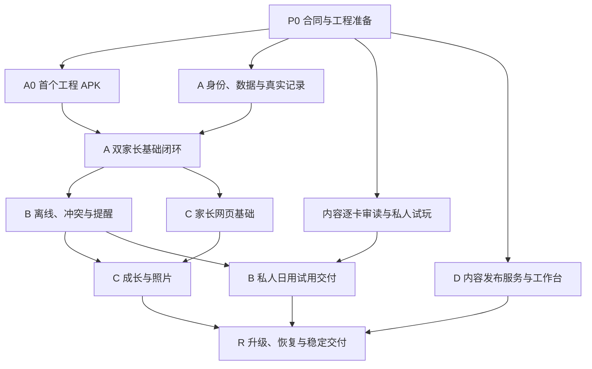

# BabyPlan 详细开发计划

计划版本：1.0 · 2026-11-13。基于 v2 产品、交互、架构和内容设计。本次完成计划及交叉核对，**尚未开始 Flutter App、真实服务和数据库的业务实现**。

面向家长的阅读版：[开发计划总览](../../deliverables/v2/开发计划.html)。可执行任务以 [开发任务清单.json](../development/开发任务清单.json) 为状态来源，阅读版任务表由它生成。

## 1. 先交付什么

首个实际产品目标：家长在 Android 手机上查看今天怎么玩，保存一次陪伴记录；爸爸妈妈使用各自账号，能够读到同一个孩子的安排和记录。随后把真实离线、冲突恢复和系统提醒做可靠，进入私人家庭试用。

首版包含：私人账号与邀请、一个孩子、今日六项及七天安排、活动详情、玩了/跳过/撤销/再玩一次、换活动、轻松一天、已有书架、阶段支持、离线记录、双人同步、本地提醒与必要设置。

后续交付：故事/原话/第一次、本人测量、私有照片、家长网页、打印与导出、内容工作台，以及完整备份恢复和稳定使用交付。完整网页和工作台不作为首个 APK 的前置条件。

继续沿用既有设计：Flutter＋SQLite；React＋TypeScript；Fastify＋TypeScript＋PostgreSQL；私有媒体存储与一个 worker。具体依赖版本、SQLite 适配库和客户端状态管理库在准备阶段验证并锁定，不在多个代理中分别选型。初期服务保持模块化单体。

## 2. 开工依据和当前环境

依据顺序：本计划的实施决定 → `docs/v2/01`～`05` 的产品规则 → 修订后的 `contracts/v2` → 对应实现与验收证据。若发现产品规则与合同冲突，先由主代理记录并统一修订，不让客户端或服务端私自选择一边。旧 v1 单设备、一日一卡合同仅供历史追溯。

2026-11-13 实际检查结果：

| 项目 | 当前事实 | 开发时的处理 |
| --- | --- | --- |
| 工程 | 没有 `apps/mobile`、真实服务工程或 `.git` | P0 建立版本管理和基础工程；不把原型搬成假服务 |
| Flutter / Dart | Flutter 3.47.5、Dart 3.13.4 可调用 | 先验证现有版本，锁定已通过构建的组合；不直接全局升级 |
| Node / npm | Node v24.14.1、npm 11.11.0 可调用 | 验证 Fastify 及依赖兼容后锁定；不用“最新”浮动依赖 |
| Android | SDK、构建工具、adb 可用；Flutter 使用 Android Studio 自带 JDK 21 | `flutter doctor -v` 提示部分许可未接受；P0 判断所需组件是否受影响，实际构建才算通过 |
| 设备 | doctor 未列出 Android 真机；列出的桌面和浏览器不是安卓设备 | 自动化和模拟器先行；真机安装、提醒、省电、选图保留单独验收 |
| 数据库 / 容器 | 当前 PATH 未发现 psql、Docker 或 Podman | 这不证明本机完全未安装；先检查已有可复用实例，否则准备项目隔离的 PostgreSQL 开发进程 |
| 网络 | doctor 访问 GitHub 超时；提示代理环境缺少 NO_PROXY | P0 验证依赖下载和本机回环访问；必要设置限于项目脚本或子进程，不改用户全局代理 |
| 内容 | 24 卡、7 天、12 条阶段支持；候选草稿 | 工程测试与私人试用分开；未核验的状态不改成“已通过” |

本轮没有接受 Android 许可、安装数据库、启动公开服务、填写真实家庭资料或更改全局配置。上述环境问题不会阻塞计划交付，但不能省略实际构建与运行检查。

## 3. 里程碑与放行条件

| 阶段 | 家长能看到的交付 | 放行条件 | 交付边界 |
| --- | --- | --- | --- |
| P0 开工准备 | 可执行的工程约定、首批合同、环境检查结果 | 身份/同步/内容门禁不再自相矛盾；开发环境可复现 | 还没有可日用 App |
| A0 首个工程 APK | 手机能安装、启动，主题和导航可看 | 实际产出 APK；安装测试记录真实设备或模拟器类型 | 内容替身明确标注；只证明构建与基础界面 |
| A 双家长基础闭环 | 登录、看今天、看玩法、保存记录、另一端读回 | 两独立账号同家庭；真实 API、PostgreSQL、SQLite；越权及重复提交测试通过 | A0 是 A 内的早期检查点，不必等所有接口完成才出包 |
| B 私人日用试用版 | 七天安排、替换、轻松一天、发现/书架/阶段、离线、提醒 | 飞行模式重启后记录仍在；双方冲突可恢复；通知真机用例有证据；试用内容已有人审读 | 服务可达范围如实说明；局域网联调不称为随时可用的外网同步 |
| C 成长与家长网页 | 成长文字、测量、照片、网页整理、打印与导出 | 文字独立可靠；媒体就绪状态真实；手机网页一致；导出和回收可验证 | 照片必须在私有存储和恢复检查完成后用于真实资料 |
| D 内容维护 | 编辑、审阅、发布、撤回工作台 | 审阅绑定具体修订；权限隔离；安全撤回阻断玩法且保留历史 | 私人试用允许真实自审；公开发布另需独立审阅 |
| R 稳定使用交付 | 更新包、部署包、操作说明、备份恢复和问题处理流程 | 清装/覆盖升级、权限、恢复、删除重放与一周试用问题闭环 | 只报告实测结果；未拿到设备或部署目标的项保持未验收 |

第一份家庭试用 APK 的范围是 A＋B；完整产品交付再包含 C＋D＋R。每次 APK 都带清晰用途、版本、内容版本、校验摘要、已验证与未验证清单。

私人试用前就固定 applicationId、可持续保管的签名来源和版本递增规则，并完成一次覆盖升级保留记录及待传草稿的检查。R 阶段继续完整升级回归，不把更新身份推迟到用户已经保存真实资料之后。

## 4. 工作顺序与关键依赖



图表示阶段关系；具体任务的前置条件以任务清单 `dependsOn` 为准。可以提前做独立的纯逻辑、页面组件、内容核对和测试样例；“能独立开始”不等于对应里程碑已经放行。

关键路径是：身份和同步合同 → 事务与数据库约束 → 计划/参与 → 两端同步 → 离线冲突与提醒 → 真机验收。幂等、删除墓碑、安全撤回、家庭权限从数据模型阶段建立，不能等产生真实记录后再补。

内容线从 P0 开始并行。首次试玩可用已经人工审读的打印手册，不必等待 App；App 的家庭试用再验证提醒、记录负担和爸妈交接。

## 5. 开工前要补齐的规则

完整依据和分级见 [接口补齐清单](../development/接口补齐清单.md)。这些是已发现的计划输入，**本轮尚未修订接口行为**。

### 首闭环之前

- 明确手机刷新令牌首次交付和轮转后的返回载体、过期及撤销语义；Web Cookie/CSRF 与手机会话分开定义。
- 私有管理员 CLI 完成首次 owner 引导与恢复凭证签发；不增加公开注册，不把恢复凭证写入日志。
- 家庭、孩子、成员显示名及权限变化有统一读取和增量传播方式。
- 参与的“撤销”、独立 session、开始/锁定的动作和修订域一致。默认浏览详情不改变开始状态，具体保护动作由合同负责人定稿。
- 同步明确一致性快照、分页/上限、墓碑、游标过期、类型化冲突载荷；本地待传数据不能被全量恢复覆盖。
- 内容区分工程测试、人工审读后的私人试用、正式发布；审核证据绑定正文 hash/revision，解决“首次试玩之前必须已完成试玩”的循环。

### 日用试用之前

- 账号指定提醒设备、启停与时刻的服务端事实，以及系统权限状态之间的边界。
- B-02 先实现设备注册、指定/切换/撤销的后端能力，B-04 再由手机接入；不能只完成本机开关却宣称账号设备绑定已生效。
- 家庭资源、排除材料、语言偏好有共同默认值和持久化；离线只使用已缓存合格候选。
- 20 分钟是目标预算，已开始/记录项保留后可以超出；界面如实解释，恢复时不重写记录。

### 对应后续模块之前

- 成长历史分页、软删/恢复/永久删除、测量方法、媒体状态、导出下载权限。
- 内容工作台读接口、审核队列、来源、发布记录与审核证据查询。

合同修改必须同时更新 `tools/build_v2_contracts.py`、生成的 OpenAPI/Schema、共享类型、样例和相关验证。共享文件由主代理统一修改，避免重建覆盖人工补丁。

## 6. 子代理如何并行

当前环境最多同时运行主代理加三个子代理。优先稳定接口和独占文件范围，再并行；一个代理未完成依赖时，可以写纯逻辑或合约夹具，不能私造生产字段。

| 执行批次 | 主代理 | 子代理 1 | 子代理 2 | 子代理 3 |
| --- | --- | --- | --- | --- |
| P0 | 合同、共享模型、版本基线和任务状态 | Android 工具链与工程骨架 | API/数据库运行环境与迁移建议 | 内容门禁/样例/验收核对 |
| A | 集成、共享事务/迁移审核、端到端验证 | `apps/mobile/**` | `services/api/**` 中已分配模块 | 内容导入夹具与只读质量审查 |
| B | 同步协议审查、设备联调与放行 | 手机离线/冲突/提醒 | 编排、偏好、同步与撤回读路径 | 网页基础或只读质量审查，二者择一 |
| C | API 合同、媒体风险与集成 | 手机成长/照片 | 成长/媒体/worker/导出 | 家长网页 |
| D/R | 发布、备份恢复、问题分级与交付 | 安卓修复与升级 | 服务发布/撤回/运维 | 内容工作台；完成后转只读审查 |

主代理始终独占：根目录配置及说明、合同生成源与 `contracts/v2/**`、共享 DTO/类型、根依赖锁、迁移编号分配、计划状态与最终打包。迁移 SQL 可由后端代理在预分配文件中编写，主代理审核后集成；同一个 migration 文件不能同时编辑。

移动代理独占 `apps/mobile/**`，含 pubspec、路由、本地库和生成文件。首版不让两个代理同时编译或改写同一 Flutter 工程。

后端代理独占明确列出的模块与测试。若同时需要两位后端代理，先分成身份/家庭与内容/计划两个目录；服务注册入口、共享事务和迁移仍只由一位负责人写。

网页初期由一位代理独占 `apps/web/**`。后续分家长区和管理区时，必须先划定 `src/parent/**`、`src/admin/**`，共享路由和组件由一人集成。

内容代理只写指定内容源和审读草案；正式审核状态必须来自真实证据。质量代理默认只读，只有获分配的测试/报告文件可写。

目前没有 Git，不能假定有 worktree。P0 建立本地 Git 基线后可按需要隔离工作目录；不因为多代理而默认创建远程仓库、提交到远端或发布。

### 每次委派的模板

```text
任务：清单 ID、目标和所属里程碑。
前置：已满足的任务 ID、冻结合同版本、参考文件。
可写：明确目录或文件；其余只读。
禁止：改公共合同/锁文件/他人目录；改全局配置；自行推送或部署；再委派。
交付：代码或文档、实际检查、失败与未验证项、涉及合同变更的建议。
完成条件：本任务验收通过并交主代理复核，不自行宣告整个版本已完成。
```

返回结果至少包含：修改文件、解决的行为、真实/替身数据边界、命令与结果、设备和环境、剩余问题。代理完成后，主代理查看真实文件与差异，集成后再做必要验证。

## 7. 内容与技术并行推进

详细步骤见 [内容审读与发布验收](../development/内容审读与发布验收.md)。

1. **工程测试**：使用明确隔离的合成内容和测试账号，验证导入、计划和界面。不能把改成 reviewed 的夹具当真实审核证据。
2. **私人试用前**：逐卡人工审读中文指令、材料、停止出口、英语与来源，留下真实身份/日期/正文 hash。允许家长同人多角色，明确自审；AI 负责整理与指出问题，不代填人工审核。
3. **私人试用**：先试已审读条目，记录成人能否看懂、材料是否好找、步骤是否顺手、记录是否费事，不评价宝宝达标率。有疑虑的条目先停用。
4. **稳定内容**：根据反馈修订，重新审读变更部分，绑定明确版本。专业审阅状态保持真实；公开发布前按产品 Q11 取得独立审阅。

首批保留 18～23 月的 24 张候选与首周安排。24/30/36 月阶段支持不是整套后续活动包；扩龄内容作为后续独立批次，不影响当前孩子首版落地。既有绘本版本不明时继续标注待核，不新增购买前提。

## 8. 验证与完成标准

| 阶段 | 重点自动化 | 必须另外记录的证据 | 对应原验收 |
| --- | --- | --- | --- |
| P0/A | 合同/导入、家庭隔离、邀请、并发计划、事务幂等、首次保存和读回 | APK 实际安装；两个独立账号；真实 API 与数据库 | V201、V202、V204、V205、V207、V212、V217 |
| B | 日期/跨午夜、队列重试、晚到响应、冲突、410 恢复、模式保护、撤回 | Android 飞行模式重启、锁屏/省电/权限/重启提醒、两机真实冲突、字号和 TalkBack | V203、V206、V208、V209、V213、V215、V217 |
| C | 媒体隔离/校验/中断、文字先存、测量、恢复、导出 | 系统选图、手机网页互读、打印、媒体恢复抽样 | V210、V211、V212、V213、V216、V217 |
| D/R | 审批失效、角色、发布失败、撤回、备份与删除重放 | 真实恢复耗时和核对清单；清装/升级；一周使用问题处理 | V214、V215、V218，加相关全链路回归 |

一条 V 用例涉及多个阶段时，注明已验证子场景，不提前把整个 V 编号标记为通过。网页原型检查不能作为 Android 或真实服务的验证记录。

测试集中在高影响行为：数据丢失、重复、越权、冲突、撤回与上传恢复。纯文字或低影响样式变更做针对性预览；相关检查通过后，没有新变更、失败或未解决疑点就不重复全量测试。

每项任务的完成定义：范围内实现完成；合同/文档一致；适当测试有证据；已集成；存在的限制准确记录。`planned → in_progress → review → done`；确实缺外部条件时使用 `blocked` 并说明影响范围，不把整个项目停住。JSON 中的任务状态是项目记录，不是 Codex 自动 Goal 状态。

证据建议放在 `docs/development/evidence/<阶段>/`，字段包括构建/源码标识、内容版本、设备系统、用例、步骤、结果、脱敏日志或截图和未验证项。构建产物放在 `releases/<版本>/`，不混入设计截图。

## 9. 发布、恢复和资料保护

- 开发环境和家庭环境分配置；初期无公开注册、不带演示家庭进入真实资料。APK 不内置数据库密码或管理员凭证。
- 首次保存真实家庭记录前，提供数据库备份和最小恢复验证；引入真实照片前，再验证私有媒体备份及数据库一致性。完整恢复演练在 R 阶段完成，不等到那时才开始备份。
- 提醒由设备本地执行，按账号选定设备；关闭/登出/20 点后不补发。离线设备无法即时获知另一端记录或撤回，界面说明真实边界。
- 环境准备优先本地隔离和可重建脚本；已有容器引擎可复用，无容器也应能开展 API 和 PostgreSQL 集成测试。
- 部署包先做成可检查的结果。没有目标服务器/凭证时，继续完成本机和隔离环境验证；不宣称已部署，也不自动选收费云服务或向外发送家庭数据。
- 数据库迁移先在备份副本演练；应用回退与数据库回退分别说明。正式升级遇到不兼容迁移，禁止盲目回装旧 APK 覆盖数据。
- 每日备份、RPO 24 小时和 RTO 4 小时沿用架构中的目标；是否达成以实际恢复演练为准。永久删除要重放墓碑，避免备份恢复后复活。
- B-05/B-06 先验证私人试用签名与升级数据保留；后续沿用该安装身份。签名秘密由安全存储保管，不进入源码、任务正文或交付 ZIP。

## 10. 节奏与优先级

采用交付批次而非预先承诺某个日期。任务大小标为 S/M/L：S 为单一明确改动，M 为单模块及验证，L 为跨模块/故障恢复或高风险工作，执行时继续拆分。

P0 完成后，用第一次构建和 A 阶段接口联调的实际速度再排日历；真机、许可证、网络和内容审读的等待单独记录。三个子代理能缩短独立任务等待，但关键路径和验收时间不能除以三。

每一批交付都说明“现在能用什么、哪些还未验证、下一批解决什么”。优先处理越权、数据丢失/重复和安全撤回问题，其次是主要流程阻断，再处理文案与外观细节。

### 第一批可以直接执行的工作

1. P0-01/02：建立源代码与忽略规则、记录版本、验证 Android 构建和本地数据库路径。
2. P0-03/04/05：主代理补身份、同步、内容门禁合同，并统一 DTO、数据约束与测试样例。
3. A-01/02/04：移动工程、服务基础、SQLite 持久化骨架按目录并行。
4. A-03/05/06/07：身份家庭、内容导入、计划、参与记录逐步接通真实 API。
5. A-08/09/10/11：集成同步、账号、今天页面，交第一份双家长闭环 APK 与验证报告。

## 11. 配套文件与核对来源

- [开发任务清单](../development/开发任务清单.json)：唯一任务状态、依赖、负责人、交付和验收。
- [接口补齐清单](../development/接口补齐清单.md)：实际合同缺口和分阶段修复要求。
- [客户端交付与验收](../development/客户端交付与验收.md)：手机与家长网页任务细分。
- [内容审读与发布验收](../development/内容审读与发布验收.md)：内容线、真实审读和设备验收。
- [并行协作说明](../development/并行协作说明.md)：文件所有权、交接与集成顺序。

技术依据于 2026-11-13 核对：Flutter 官方区分 UI、数据层、Repository 与 Service，支持本计划对可独立测试边界的安排，具体状态库仍需工程验证。[Flutter 架构指南](https://docs.flutter.dev/app-architecture/guide)

依赖组合在 P0 依据对应 Fastify 主版本的支持矩阵核对，不从本机 Node 版本反推所有插件均已兼容。[Fastify LTS](https://fastify.dev/docs/latest/Reference/LTS/)

Android 通知存在运行时权限流程，所以本计划把拒绝、关闭和恢复列为真机验收；具体插件不能代替系统行为验证。[Android 通知权限](https://developer.android.com/develop/ui/compose/notifications/notification-permission)

备份要有恢复路径与实际验证，本计划按数据库和媒体共同恢复制定交付要求；数据库方法参考官方文档，媒体一致性属于本项目额外设计。[PostgreSQL 备份与恢复](https://www.postgresql.org/docs/current/backup.html)
